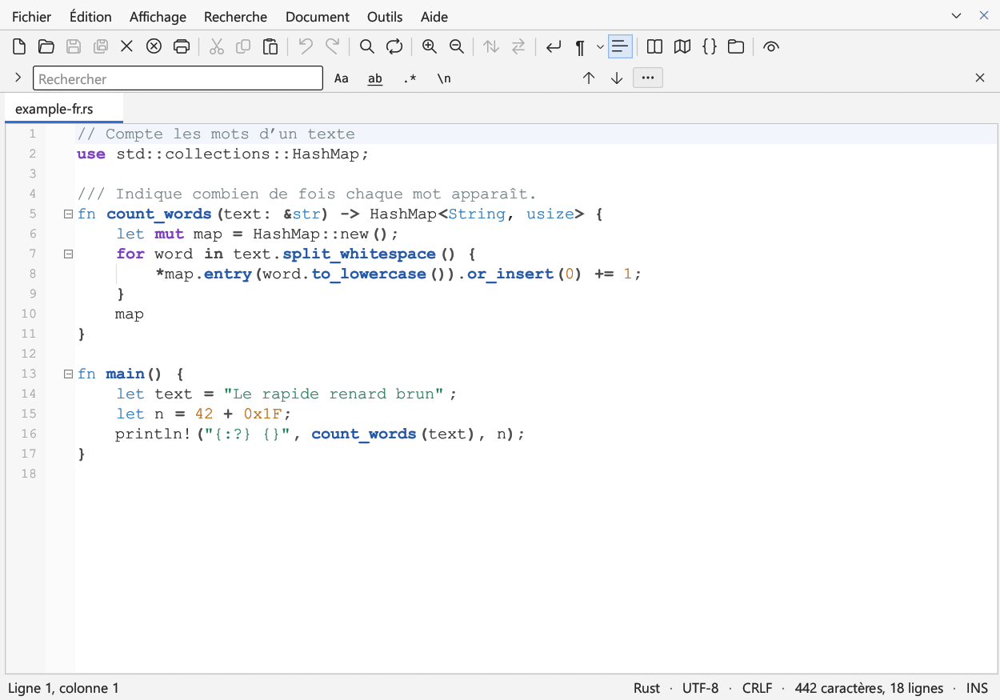
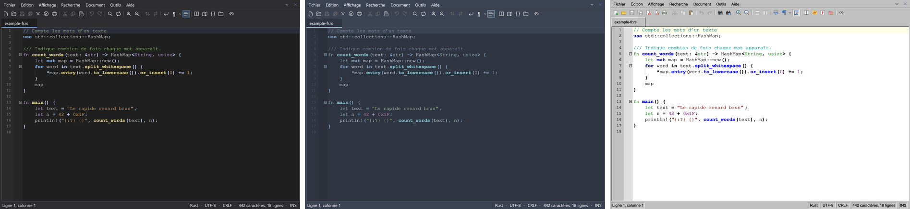

# Quillpad

[English](README.md) · [Deutsch](README.de.md) · **Français**

Un éditeur de texte rapide pour Windows et Linux, écrit en Rust avec [egui](https://github.com/emilk/egui).



## Fonctionnalités

- Onglets, vue partagée avec défilement synchronisé, sessions qui conservent le texte non enregistré
- Coloration syntaxique pour plus de 100 langages, plan, vue d’ensemble et dossier de projet
- Barre de recherche avec compteur en direct, expressions régulières et séquences d’échappement ; rechercher et remplacer dans les fichiers
- Curseurs multiples, sélection en bloc, signets, repli, outils de lignes, suites de nombres
- Les encodages (UTF-8, UTF-16, ANSI et d’autres jeux de caractères) et les fins de ligne sont conservés à l’enregistrement
- Neuf thèmes de couleurs, dont Solarized, Nord, Monokai, Sépia, Contraste élevé et un style Windows 98
- Interface en anglais, allemand et français (suit la langue du système)
- Avis lorsqu’une nouvelle version est disponible (désactivable)



## Télécharger et installer

Les programmes prêts à l’emploi se trouvent dans les [Releases](https://github.com/RayTrunk/quillpad/releases).

- **Windows :** `quillpad-<version>-windows-x64-setup.exe` installe Quillpad sans droits d’administrateur
  (au choix pour tous les utilisateurs), avec une entrée dans le menu Démarrer, « Ouvrir avec » pour les
  fichiers texte et, si vous le souhaitez, « Modifier avec Quillpad » dans le menu contextuel.
  Pour ne rien installer, utilisez le fichier `.exe` seul.
- **Linux :** décompressez `quillpad-<version>-linux-x64.tar.gz` puis lancez `./install.sh` ; Quillpad
  apparaît alors dans le menu des applications et dans « Ouvrir avec ». Détails dans `LISEZMOI-LINUX.txt`.

Les programmes ne sont pas signés ; Windows SmartScreen demande donc une confirmation au premier lancement.

## Compiler soi-même

Installez Rust depuis [rustup.rs](https://rustup.rs), puis :

```
cargo build --release
```

Le programme se trouve ensuite dans `target/release/`. Les tests se lancent avec `cargo test`.
Pour créer l’installateur Windows, exécutez `ISCC packaging\windows\quillpad.iss` avec
[Inno Setup](https://jrsoftware.org/isinfo.php) après la compilation.

Les traductions se trouvent dans `locales/<langue>/*.toml` ; un test vérifie que toutes les langues ont les mêmes clés.

## Licence

© 2026 R. Trunk

Quillpad est un logiciel libre : vous pouvez le redistribuer et/ou le modifier selon les termes de la
[licence publique générale GNU](LICENSE), version 3 ou (à votre choix) toute version ultérieure.
Quillpad est distribué sans aucune garantie.
