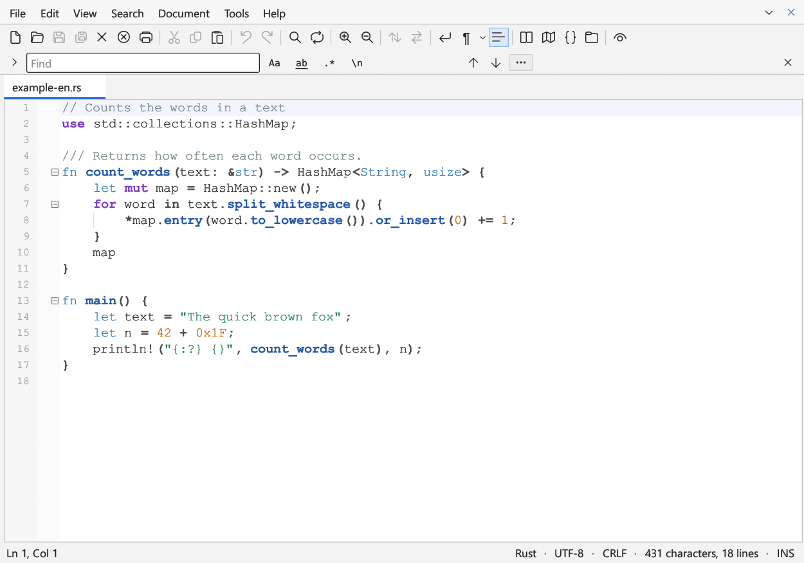
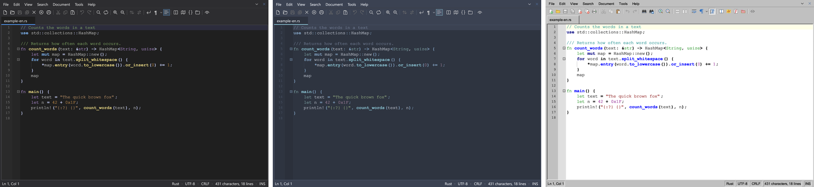

# Quillpad

**English** · [Deutsch](README.de.md) · [Français](README.fr.md)

A fast text editor for Windows and Linux, written in Rust with [egui](https://github.com/emilk/egui).



## Features

- Tabs, split view with synchronised scrolling, sessions that keep unsaved text
- Syntax colouring for more than 100 languages, outline, overview map and project folder
- Search bar with live match counter, regular expressions and escape sequences; find and replace in files
- Multiple cursors, block selection, bookmarks, folding, line tools, number sequences
- Encodings (UTF-8, UTF-16, ANSI and other character sets) and line endings are kept when saving
- Nine colour themes, including Solarized, Nord, Monokai, Sepia, High contrast and a Windows 98 look
- User interface in English, German and French (follows the system language)
- Notice when a new version is available (can be turned off)



## Download and install

Ready-made programs are available under [Releases](https://github.com/RayTrunk/quillpad/releases).

- **Windows:** `quillpad-<version>-windows-x64-setup.exe` installs Quillpad without administrator rights
  (optionally for all users), with a Start menu entry, “Open with” for text files and, if you like, an
  “Edit with Quillpad” context menu entry. If you prefer not to install anything, use the single `.exe`.
- **Linux:** unpack `quillpad-<version>-linux-x64.tar.gz` and run `./install.sh`; Quillpad then appears
  in the application menu and under “Open with”. Details in `README-LINUX.txt`.

The programs are not signed, so Windows SmartScreen asks for confirmation on first start.

## Build it yourself

Install Rust from [rustup.rs](https://rustup.rs), then:

```
cargo build --release
```

The program is then in `target/release/`. Run the tests with `cargo test`.
To build the Windows installer, run `ISCC packaging\windows\quillpad.iss` with
[Inno Setup](https://jrsoftware.org/isinfo.php) after the release build.

Translations live in `locales/<language>/*.toml`; a test makes sure every language has the same keys.

## License

© 2026 R. Trunk

Quillpad is free software: you can redistribute it and/or modify it under the terms of the
[GNU General Public License](LICENSE), version 3 or (at your option) any later version.
Quillpad is distributed without any warranty.
